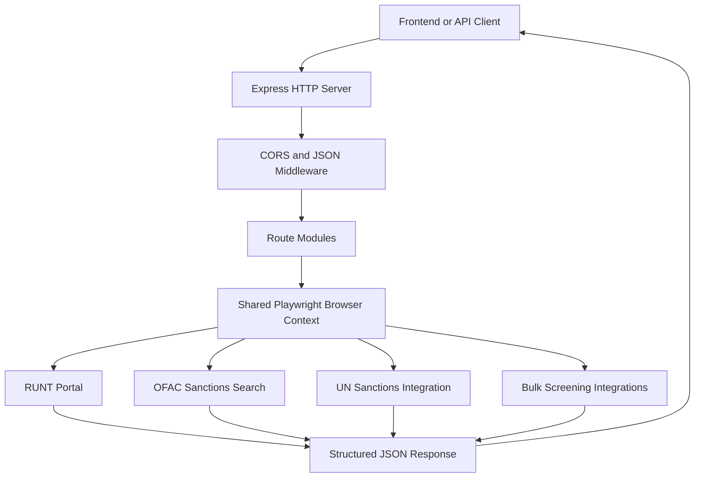
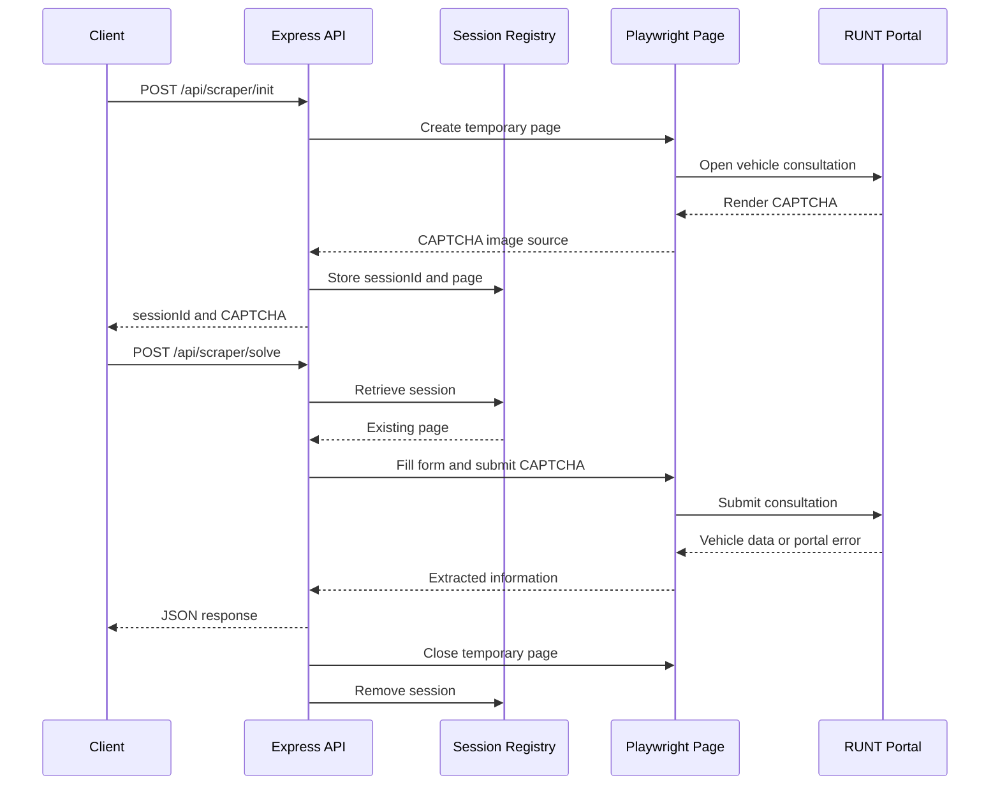

# RUNT & Compliance Scraper API

A browser automation API built with **Node.js, Express, TypeScript, and Playwright** to retrieve vehicle information from Colombia's RUNT public portal and perform name-based searches against international sanctions and compliance databases.

The service exposes HTTP endpoints that coordinate browser sessions, automate interactions with external websites, extract structured information, and return JSON responses to client applications.

## Table of Contents

- [Overview](#overview)
- [Key Features](#key-features)
- [Technology Stack](#technology-stack)
- [Architecture](#architecture)
- [Supported Integrations](#supported-integrations)
- [Getting Started](#getting-started)
- [Environment Configuration](#environment-configuration)
- [API Reference](#api-reference)
- [RUNT Query Workflow](#runt-query-workflow)
- [Response Formats](#response-formats)
- [Browser Lifecycle and Session Management](#browser-lifecycle-and-session-management)
- [Error Handling](#error-handling)
- [Security Considerations](#security-considerations)
- [Limitations and Operational Considerations](#limitations-and-operational-considerations)
- [Future Improvements](#future-improvements)

## Overview

This project provides a reusable HTTP interface for browser-based data retrieval from external portals that do not necessarily expose a suitable API for the required workflows.

Instead of implementing browser automation independently for every request, the application initializes a shared Playwright browser context and creates isolated pages for individual operations.

The API currently covers three main areas:

1. **Vehicle information retrieval:** Automates the RUNT public vehicle consultation workflow, including CAPTCHA retrieval, user-provided CAPTCHA submission, vehicle identification, and extraction of selected technical and regulatory information.
2. **Sanctions screening:** Automates name-based searches against the U.S. Department of the Treasury's Office of Foreign Assets Control (OFAC) sanctions search website.
3. **Additional compliance integrations:** Provides dedicated route modules for United Nations sanctions searches and bulk OFAC/UN processing. Their detailed behavior depends on the corresponding route implementations.

The service is designed to be consumed by frontend applications and backend systems that need a consistent JSON interface for these browser-driven operations.

> **Important:** This project automates interactions with third-party websites. It does not own the source databases, guarantee their availability, or independently determine the legal significance of a search result.

## Key Features

### Vehicle data extraction

- Automated navigation to the RUNT public vehicle consultation portal.
- Temporary browser sessions associated with generated session identifiers.
- CAPTCHA image retrieval and delivery to the client.
- Vehicle plate, document type, document number, and CAPTCHA submission.
- Extraction of selected vehicle attributes, including make, line, model, color, engine displacement, fuel type, passenger capacity, and vehicle classification.
- Retrieval of selected SOAT and technical inspection (RTM) information when available.
- Date normalization from `DD/MM/YYYY` to `YYYY-MM-DD`.
- Structured JSON responses suitable for integration with other applications.

### Sanctions screening

- Automated navigation to the OFAC Sanctions List Search website.
- Name-based search submission.
- Detection of visible search results or a no-results message.
- Extraction of selected fields from the first returned result, including program, list, and score.
- In-memory screenshot capture encoded as Base64.

### Browser automation infrastructure

- Express-based HTTP routing.
- TypeScript implementation.
- Playwright Chromium automation.
- Shared browser context initialized at startup.
- Temporary pages for independent browser operations.
- Configurable HTTP port through an environment variable.
- A basic health-check endpoint.
- Centralized Express error middleware.

## Technology Stack

| Technology | Purpose |
|---|---|
| Node.js | JavaScript runtime |
| TypeScript | Static typing and maintainable application code |
| Express | HTTP server, middleware, and API routing |
| Playwright | Browser automation and DOM interaction |
| Chromium | Headless browser execution |
| CORS | Cross-origin request handling |
| JSON | Request and response data exchange |

## Architecture

The application separates HTTP routing from browser initialization.



### Application responsibilities

**Server entry point**

The server entry point:

- Configures Express middleware.
- Launches Chromium.
- Creates a shared `BrowserContext`.
- Performs a startup warm-up against the RUNT portal.
- Registers the route modules.
- Exposes the health-check endpoint.
- Starts listening for HTTP requests after successful browser initialization.

**Route modules**

Each route module encapsulates a particular integration or workflow. Route factories receive a function that provides access to the initialized browser context.

For example:

```typescript
export default function createRuntRoutes(
  getGlobalContext: () => BrowserContext,
) {
  const router = Router();

  // Register RUNT endpoints here.

  return router;
}
```

Passing a context accessor avoids importing the server entry point from individual route modules and helps prevent circular dependencies.

**Browser context and pages**

The shared context acts as the browser environment for individual operations. Each operation creates its own page instead of navigating a single global page for every request.

This separation is particularly important for the RUNT workflow, where a CAPTCHA must be retrieved and then submitted as part of the same browser session.

**Response layer**

The route handlers translate browser interactions into HTTP responses containing success indicators, messages, extracted data, and—in selected workflows—screenshots.

## Supported Integrations

| Integration | Purpose | Implementation status in the supplied code |
|---|---|---|
| RUNT | Vehicle consultation and data extraction | Initialization and solve workflows provided |
| OFAC | Name-based sanctions screening | Search workflow provided |
| United Nations (UN) | Sanctions screening | Dedicated route module registered |
| Bulk OFAC | Bulk sanctions screening | Dedicated route module registered |
| Bulk UN | Bulk sanctions screening | Dedicated route module registered |

External sources:

- [RUNT Public Portal](https://portalpublico.runt.gov.co/)
- [OFAC Sanctions List Search](https://sanctionssearch.ofac.treas.gov/)
- [United Nations Security Council Consolidated List](https://main.un.org/securitycouncil/en/content/un-sc-consolidated-list)

The UN and bulk integrations are registered by the server, but their endpoint contracts and processing details should be documented after reviewing their individual route files.

## Getting Started

### Prerequisites

Before running the project, ensure that you have:

- A supported Node.js installation.
- npm or another compatible package manager.
- Access to the project repository.
- Network access to the external portals.
- A compatible Playwright Chromium installation.

### 1. Clone the repository

```bash
git clone https://github.com/spjhon/Project-api-runt-scrapping.git
cd Project-api-runt-scrapping
```

### 2. Install dependencies

```bash
npm install
```

### 3. Install the Playwright browser

```bash
npx playwright install chromium
```

On supported Linux environments, you may also need the required system dependencies:

```bash
npx playwright install --with-deps chromium
```

### 4. Configure environment variables

Create a local `.env` file if your application uses a dotenv loader, or configure the variables directly in your environment.

```env
PORT=3001
```

The application defaults to port `3001` when `PORT` is not defined.

### 5. Start the application

Use the script configured in your `package.json`. For example, if the repository defines these scripts:

```bash
npm run dev
```

For a compiled production build, the workflow may look like this:

```bash
npm run build
npm start
```

These commands depend on the scripts configured in the repository; the server code alone does not establish their exact names.

### 6. Verify the service

With the server running, open:

```text
http://localhost:3001/health
```

Expected response:

```json
{
  "success": true,
  "message": "Scraper API funcionando correctamente."
}
```

This endpoint confirms that Express is responding. It does not independently verify that every external portal is reachable or that every scraper workflow is operational.

## Environment Configuration

| Variable | Required | Default | Description |
|---|---|---|---|
| `PORT` | No | `3001` | HTTP port used by the Express server |

The supplied server code does not require credentials for the displayed public-portal workflows. Additional route modules or future integrations may introduce other configuration requirements.

## API Reference

All the supplied route modules are mounted under:

```text
/api/scraper
```

### 1. RUNT — Initialize a consultation

**Endpoint**

```http
POST /api/scraper/init
```

Creates a temporary browser page, navigates to the RUNT public vehicle consultation portal, waits for the CAPTCHA image, and returns a session identifier together with the image source.

**Request body**

No request body is required by the supplied implementation.

**Example response**

```json
{
  "success": true,
  "sessionId": "generated-session-id",
  "captcha": "data:image/...",
  "message": "Pestaña lista y captcha enviado."
}
```

The actual `sessionId` and CAPTCHA value are generated at runtime.

The client must retain the session identifier and submit it in the next request.

### 2. RUNT — Solve the consultation

**Endpoint**

```http
POST /api/scraper/solve
```

Uses the browser page associated with the previously generated session identifier to submit the vehicle consultation form and extract the resulting information.

**Request body**

```json
{
  "sessionId": "generated-session-id",
  "tipoDocumento": "cedula_ciudadania",
  "numeroDocumento": "DOCUMENT_NUMBER",
  "captchaValue": "USER_ENTERED_CAPTCHA",
  "placa": "ABC123"
}
```

Supported document-type keys in the supplied implementation:

| Key | RUNT document label |
|---|---|
| `cedula_ciudadania` | Cédula Ciudadanía |
| `nit` | NIT |
| `pasaporte` | Pasaporte |
| `cedula_extranjeria` | Cédula de Extranjería |
| `tarjeta_identidad` | Tarjeta de Identidad |
| `registro_civil` | Registro Civil |
| `carnet_diplomatico` | Carnet Diplomático |
| `permiso_por_proteccion_temporal` | Permiso por Protección Temporal |

The current implementation defaults to `Cédula Ciudadanía` when the supplied document-type key is not recognized. Client applications should send a supported value rather than relying on that fallback.

**Processing steps**

1. Retrieve the browser session using `sessionId`.
2. Enter the vehicle plate.
3. Select the document type.
4. Enter the document number.
5. Submit the user-provided CAPTCHA value.
6. Submit the consultation.
7. Detect either a visible portal error or vehicle data.
8. Extract selected vehicle, SOAT, and RTM fields.
9. Return the extracted payload as JSON.
10. Close the session page and remove the session from the in-memory registry.

**Example success response**

```json
{
  "success": true,
  "message": "Datos extraídos correctamente desde el RUNT",
  "payload": {
    "tipo_servicio": "example",
    "clase_vehiculo": "example",
    "soat": "2027-04-30",
    "marca_vehiculo": "EXAMPLE",
    "lineaVehiculo": "EXAMPLE",
    "modelo_vehiculo": "2025",
    "color_vehiculo": "EXAMPLE",
    "cilindrada_vehiculo": "150",
    "combustible_vehiculo": "gasolina",
    "es_ensenanza": false,
    "capacidad_pasajeros": "2",
    "se_encontro_fecha_vencimiento_RTM": "SI",
    "fecha_vencimiento_RTM": "2027-04-30",
    "organismo_que_expidio_la_ultima_RTM": "EXAMPLE",
    "RTM_vigente_de_acuerdo_al_runt": "SI",
    "fecha_matricula": "2025-01-15",
    "SOAT_vigente_de_acuerdo_al_RUNT": "VIGENTE"
  }
}
```

This is an illustrative response showing the current payload structure. Values are examples, not real vehicle records, and the actual field values depend on the portal response.

**Example expired or missing session response**

```json
{
  "success": false,
  "message": "La sesión del navegador expiró o no existe. Por favor, recarga el captcha."
}
```

### 3. OFAC — Search the sanctions list

**Endpoint**

```http
POST /api/scraper/sarlaft/ofac/init
```

Navigates to the OFAC Sanctions List Search website, submits a name-based search, and detects whether results or a no-results message are displayed.

**Request body**

```json
{
  "numeroDocumento": "DOCUMENT_NUMBER",
  "nombreCompleto": "EXAMPLE PERSON"
}
```

The supplied implementation uses `nombreCompleto` for the search. Although `numeroDocumento` is accepted in the request body, it is not used in the shown search logic.

**Example response — no matches**

```json
{
  "success": true,
  "coincidencia": false,
  "message": "No se encontraron coincidencias en OFAC.",
  "resultado": null,
  "screenshot": "BASE64_ENCODED_JPEG"
}
```

**Example response — a result was found**

```json
{
  "success": true,
  "coincidencia": true,
  "message": "Se encontraron coincidencias en OFAC.",
  "resultado": {
    "program": "EXAMPLE PROGRAM",
    "list": "EXAMPLE LIST",
    "score": "EXAMPLE SCORE"
  },
  "screenshot": "BASE64_ENCODED_JPEG"
}
```

The supplied implementation extracts the first visible result row and returns a full-page JPEG screenshot encoded as Base64. It does not return every matching row.

A detected match should be treated as a screening result requiring review, not as proof that the searched person is the listed individual.

### 4. Health check

**Endpoint**

```http
GET /health
```

Returns a simple JSON response indicating that the Express application is responding.

This endpoint is useful for basic process monitoring and deployment checks.

### 5. United Nations and bulk endpoints

The server registers the following additional route modules:

- `sarlaftUNRoutes`
- `sarlaftMasivoOFACRoutes`
- `sarlaftMasivoUNRoutes`

Their route prefixes, request schemas, response payloads, and processing semantics must be confirmed from their source files before documenting specific endpoint paths.

## RUNT Query Workflow

The RUNT integration uses a two-request workflow because the CAPTCHA must be presented to the client before the consultation can be submitted.



This workflow preserves the browser page between the initialization and submission requests. Creating a new page for the second request would lose the original page state and break the intended session flow.

The CAPTCHA is supplied by the portal and submitted by the client. The shown implementation does not automatically solve CAPTCHA challenges.

## Response Formats

The API uses JSON for its HTTP responses.

Common response fields include:

| Field | Meaning |
|---|---|
| `success` | Indicates whether the requested operation completed according to the route's logic |
| `message` | Human-readable status or error description |
| `payload` | Extracted RUNT information |
| `resultado` | Selected OFAC search result, or `null` |
| `coincidencia` | Indicates whether the OFAC search displayed a result |
| `screenshot` | Base64-encoded JPEG image for the OFAC workflow |
| `sessionId` | Identifier for a temporary RUNT browser session |
| `captcha` | CAPTCHA image source returned during RUNT initialization |

The precise response shape depends on the endpoint.

A successful HTTP response does not necessarily mean a person has been cleared from a sanctions list or that the external data is complete. Consumers should interpret the business meaning of each field separately from the HTTP status.

## Browser Lifecycle and Session Management

### Startup initialization

Before accepting requests, the server:

1. Launches Chromium in headless mode.
2. Creates the shared browser context.
3. Opens a warm-up page.
4. Navigates to the RUNT public portal.
5. Waits for a visible form-related element.
6. Performs a short stabilization delay.
7. Starts the HTTP listener.

If browser initialization or the warm-up fails, the current startup flow logs the error and exits the process.

Consequently, a temporary RUNT availability issue can prevent the entire API from starting, including integrations that do not depend on RUNT.

### Temporary RUNT sessions

The RUNT route module stores active sessions in an in-memory `Map`.

Each session contains:

- A session identifier.
- A Playwright `Page`.
- A creation timestamp.

The configured session timeout is 30 seconds. A periodic cleanup task closes expired pages and removes their entries.

The session registry is process-local. It is not shared across application instances, containers, or restarts.

### Page cleanup

The RUNT solve handler closes its page in a `finally` block and removes the associated session from the registry.

The OFAC handler closes its page after preparing a response or when an error occurs.

This lifecycle management helps prevent abandoned browser pages from accumulating during normal operation.

## Error Handling

The application includes route-level error handling and a centralized Express error middleware.

Typical failure scenarios include:

- Chromium cannot launch.
- The RUNT portal cannot be reached.
- A required page element does not appear within its timeout.
- The CAPTCHA image cannot be retrieved.
- A RUNT session has expired or cannot be found.
- The external portal returns an error or unexpected page structure.
- The OFAC search does not display either expected result state before the timeout.

The server-level error middleware returns a generic HTTP 500 response for errors passed to it.

Individual route handlers may return their own response formats. For example, the RUNT solve endpoint returns an HTTP 200 response for a portal-level error detected inside the page, with `success: false` in the JSON body.

API consumers should therefore inspect both the HTTP status and the response body rather than relying exclusively on the status code.

## Security Considerations

This service interacts with public portals and processes information that may include personal identifiers and vehicle records. Security should be treated as a core deployment requirement.

### Restrict CORS

The supplied code uses:

```typescript
app.use(cors());
```

This enables broad cross-origin access by default. Production deployments should configure an explicit origin allowlist appropriate for the authorized frontend applications.

CORS is a browser access policy, not an authentication or authorization mechanism.

### Add authentication and authorization

The supplied server code does not show API authentication, authorization, or per-client quotas.

Before exposing the service publicly, consider implementing:

- API authentication.
- Endpoint-level authorization.
- Rate limiting and request throttling.
- Request body validation.
- Maximum request sizes.
- Abuse monitoring and structured audit logs.

### Protect session identifiers

The RUNT session identifier associates a client request with a live browser page. It should be treated as a sensitive, temporary capability.

A cryptographically secure identifier, expiration enforcement, and protection against session guessing or unauthorized reuse are preferable to `Math.random()`.

### Avoid exposing internal errors

The supplied route handlers return raw error messages in some responses. In production, return safe public error messages and keep diagnostic details in server-side logs.

### Handle screenshots and personal data carefully

Base64-encoded screenshots may contain personal information or other sensitive content. Restrict access, avoid logging full payloads, and apply suitable retention and transmission controls.

### Review legal and operational requirements

Use the external portals in accordance with their applicable terms, access policies, and relevant law. Sanctions screening results require appropriate human review and should not be treated as definitive identity matches based solely on a name or similarity score.

## Limitations and Operational Considerations

The current implementation has several important operational characteristics:

- **DOM dependency:** Selectors are tied to the current markup of third-party portals and may need maintenance when those websites change.
- **External availability:** Portal downtime, network latency, rate limits, and anti-automation measures may affect request success.
- **Shared browser context:** Multiple pages use a common context, so context-level state and concurrent operations should be assessed carefully.
- **In-memory sessions:** Active RUNT sessions are lost when the process restarts and are not available to other server instances.
- **Timeout coordination:** The RUNT session timeout is 30 seconds, while cleanup runs every 120 seconds. An expired session may remain in memory until the cleanup task runs unless another code path removes it.
- **Startup dependency:** RUNT warm-up is a startup prerequisite, even though other integrations may not require the RUNT portal.
- **OFAC result scope:** The current route extracts only the first displayed match.
- **Health-check scope:** `/health` verifies the Express response, not the operational status of Chromium or external integrations.
- **Request validation:** The shown handlers do not comprehensively validate request bodies before using their values.
- **Deployment scaling:** Multi-instance deployments require a deliberate strategy for session affinity or externalized session coordination.

These are characteristics of the code provided and should be reassessed as the application evolves.

## Future Improvements

Potential next steps include:

- Replace weak session identifiers with cryptographically secure IDs.
- Enforce session expiration at lookup time and clean up sessions on a reliable schedule.
- Add request validation with a schema-validation library.
- Configure CORS through environment-specific allowlists.
- Introduce API authentication and rate limiting.
- Add structured logging, metrics, and integration-level health checks.
- Improve selectors by preferring stable accessible roles, labels, and attributes where available.
- Implement retries and controlled timeouts for transient navigation failures.
- Separate startup health from individual third-party portal availability.
- Review concurrency limits and browser resource consumption.
- Document the complete contracts for the UN and bulk screening endpoints.
- Add automated tests using mocked browser pages and controlled test fixtures.
- Define a clear retention policy for screenshots and extracted personal data.

## Project Status

The repository contains an Express and Playwright foundation for browser-based vehicle data extraction and sanctions screening, with modular route registration and JSON-based responses.

The RUNT initialization and consultation workflow and the OFAC name-search workflow are documented from the supplied source code. Additional integrations are registered but require their corresponding implementations to fully document their API contracts.

---

**Disclaimer:** This project is an independent technical integration. It is not an official RUNT, OFAC, or United Nations product, and no affiliation or endorsement by those organizations is implied. External websites, data availability, and search results are outside the application's control.
